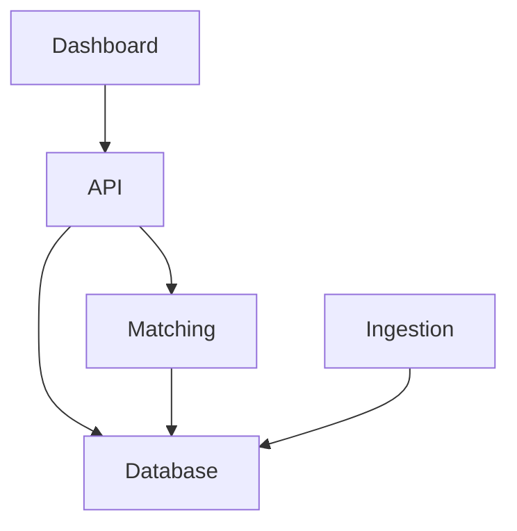

# System Architecture

## Architectural Principles

TurnLot's architecture is guided by the following principles.

### Modularity

TurnLot is composed of independently maintained components with clearly defined responsibilities, interfaces, and dependencies.

Each component encapsulates its functionality to minimize coupling and support independent development.

### Extensibility

The architecture accommodates new data providers, integrations, and platform capabilities without requiring fundamental changes to existing component boundaries.

### Scalability

The architecture is designed to accommodate increasing numbers of dealerships, users, and processing workloads while maintaining efficient operation.

### Reliability

The architecture supports consistent operation, fault isolation, and recovery from failures without compromising data integrity.

### Security

The architecture protects sensitive dealership and customer data through defined access boundaries, controlled interfaces, and appropriate security mechanisms.

## System Components

TurnLot's components are organized into three categories based on their architectural roles.

### Platform

The platform provides the infrastructure and operational foundation supporting TurnLot's applications and shared libraries.

#### Infrastructure

The [`infrastructure`](https://github.com/turnlot/infrastructure) repository manages TurnLot's cloud infrastructure and deployment environments.

It provides the underlying resources and configuration required to operate the platform.

### Applications

Applications execute TurnLot's business workflows and provide interfaces for users and other system components.

#### Dashboard

The [`dashboard`](https://github.com/turnlot/dashboard) repository provides TurnLot's user-facing web application.

It enables authorized dealership personnel to view matching opportunities and interact with supported platform functionality.

#### API

The [`api`](https://github.com/turnlot/api) repository provides authenticated application interfaces for accessing TurnLot's data and functionality.

It serves as the backend interface between client applications and the platform's underlying services.

#### Ingestion

The [`ingestion`](https://github.com/turnlot/ingestion) repository manages the ingestion and normalization of dealership CRM and inventory data.

It accommodates varying source formats and provides standardized data for downstream processing.

### Shared Libraries

Shared libraries provide reusable functionality and data interfaces consumed by TurnLot's applications.

#### Database

The [`database`](https://github.com/turnlot/database) repository maintains TurnLot's shared data models, database schema, and migrations.

It provides reusable persistence interfaces for accessing and managing dealership and operational data.

#### Matching

The [`matching`](https://github.com/turnlot/matching) repository manages the identification and evaluation of potential matches between dealership vehicle interests and inventory.

It encapsulates reusable matching logic independently of data ingestion and application interfaces.

## Component Dependencies

TurnLot's components interact through shared packages and defined application interfaces.

Arrows represent application interfaces or package dependencies, not processing order. Infrastructure supports the deployment and operation of these components.

TurnLot distributes shared packages through AWS CodeArtifact. Package specifications and dependency management are maintained in their respective repositories.

Processing workflows are documented separately in [Data Flow](data-flow.md).

## Technology Stack

TurnLot is built primarily with Python, PostgreSQL, and AWS.

Component-specific technologies, frameworks, and dependencies are documented in their respective repositories.