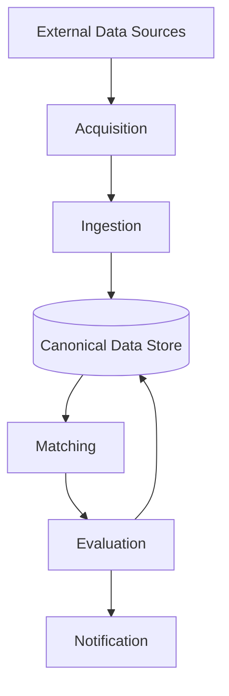

# Data Flow

TurnLot's data flow defines how information moves through the platform, from external data sources to match evaluation and notification.

It establishes logical processing stages independently of specific technologies, data providers, and execution schedules.

## Overview

TurnLot processes dealership sales opportunities and vehicle inventory through six stages:

1. **Acquisition** — Receive information from external data sources.
2. **Ingestion** — Interpret, validate, normalize, and reconcile source data.
3. **Persistence** — Maintain canonical business records and provenance.
4. **Matching** — Identify compatible lead interests and inventory listings.
5. **Evaluation** — Assess compatibility and preserve evaluation results.
6. **Notification** — Determine eligibility and deliver qualifying communications.

## Data Flow

The diagram represents logical information flow rather than individual services or execution boundaries.

## Processing Stages

### Acquisition

Acquisition receives information from configured external systems and datasets.

Sources may provide customer records, sales opportunities, vehicle interests, and inventory information through files, APIs, or other authorized integrations.

Incoming information retains its source identity and relevant provenance.

### Ingestion

Ingestion transforms source-specific information into canonical domain records.

It performs schema interpretation, field mapping, validation, normalization, identity resolution, and reconciliation.

AI-assisted interpretation may accommodate heterogeneous source schemas, but inferred information remains distinguishable from verified source data.

Repeated ingestion must not create unintended duplicate records or overwrite more authoritative information.

### Persistence

Persistence maintains canonical entities independently of their originating source formats.

It preserves internal identities, organizational ownership, source provenance, lifecycle states, and relevant historical information.

Data access and modifications respect established authorization boundaries.

### Matching

Matching identifies compatibility between lead interests and inventory listings using canonical records.

Matching may combine deterministic criteria with AI-assisted evaluation.

Compatibility is independent of lead lifecycle status and business-specific matching eligibility.

### Evaluation

Evaluation records compatibility assessments associated with matches.

Evaluations may contain outcomes, scores, supporting information, and methodology versions.

Multiple evaluations may exist for the same match. Finalized results remain historically stable.

### Notification

Notification processing determines whether a qualifying business event warrants communication.

Eligibility considers compatibility, applicable business rules, inventory state, and prior notifications.

Notifications maintain independent delivery lifecycles. Reprocessing must not generate duplicate notifications for the same qualifying event.

## Data Flow Invariants

### Validation

- Incoming data must be validated before modifying canonical records.
- AI-assisted interpretations must pass applicable validation before persistence.
- Downstream processing must not assume upstream information is complete, current, or authoritative without appropriate evidence.

### Reconciliation

- Reprocessing must be safe and must not introduce unintended duplicate business records or processing effects.
- Incomplete datasets must not imply that absent records are deleted or unavailable.
- Delayed, stale, or corrected information must not silently overwrite newer authoritative information.

### Provenance

- Source observation time must remain distinguishable from ingestion processing time.

### Fault Tolerance

- Processing failures must remain identifiable and must not invalidate successfully completed independent stages.