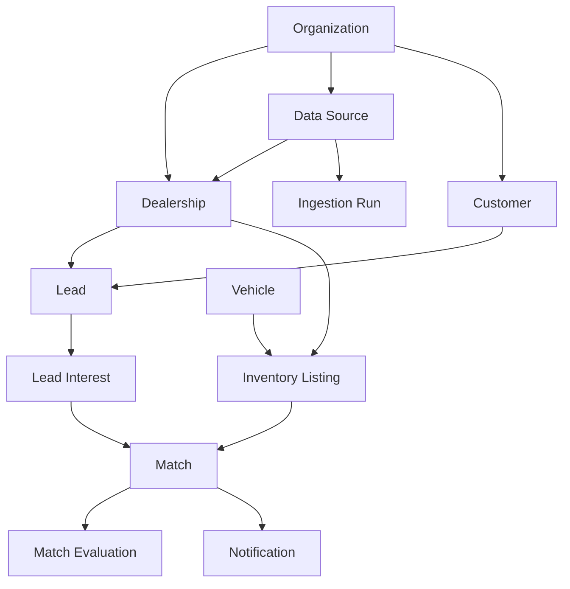

# Domain Model

TurnLot's domain model defines the core business entities, their relationships, and governing rules independently of specific technologies and external data providers.

## Core Entities

### Organization

An organization represents a TurnLot customer account containing one or more dealerships.

It establishes the primary boundary for account management, data ownership, access control, and tenant isolation.

### Dealership

A dealership represents an individual automotive retail location belonging to an organization.

Each dealership maintains its own sales opportunities and inventory, although data sources may be shared across dealerships.

### Data Source

A data source represents an external system or dataset supplying information to TurnLot.

A source may serve multiple dealerships within an organization. External identifiers are interpreted within their originating source namespaces.

### Customer

A customer represents an individual or entity associated with one or more sales opportunities.

Customer identity is independent of individual opportunities. Customer records remain subject to their originating organization's ownership and access boundaries.

Records from different sources must not be assumed to represent the same customer without reliable evidence. Identity resolution across organizations requires explicit authorization.

### Lead

A lead represents an individual sales opportunity associated with a dealership.

A lead may reference a customer and contain multiple vehicle interests. Its lifecycle status is independent of its eligibility for matching.

### Lead Interest

A lead interest represents a vehicle preference or set of purchasing criteria associated with a lead.

Interests may describe specific vehicles or broader characteristics. Multiple interests can exist independently within the same opportunity.

An interest may evolve as purchasing preferences change while retaining its identity. Material changes may affect subsequent match evaluations without altering historical results.

### Vehicle

A vehicle represents a distinct physical automobile, independently of its dealership inventory records.

Its identity persists across transfers, removals, and subsequent listings. Physical identity must not be assumed from incomplete or unverified information.

### Inventory Listing

An inventory listing represents a dealership-specific inventory record or offering of a vehicle.

It maintains availability, pricing, and other listing-specific information independently of the physical vehicle.

### Match

A match represents a persistent compatibility relationship between a lead interest and an inventory listing.

Its existence does not necessarily imply that the opportunity is currently eligible for matching or notification.

### Match Evaluation

A match evaluation represents an individual compatibility assessment associated with a match.

Multiple evaluations may exist for the same match, preserving changes in scoring, methodology, and results over time.

### Notification

A notification represents an intended communication generated by a qualifying business event.

Notifications are independent of matches and may have multiple delivery attempts.

### Ingestion Run

An ingestion run represents an execution of data import or synchronization from a configured source.

It records processing outcomes and establishes provenance for imported information.

Source observation time and ingestion processing time remain distinguishable, allowing TurnLot to reason about delayed exports, stale information, and subsequent source corrections.

## Domain Relationships

Relationships are conceptual and do not prescribe database foreign keys or cardinalities.

## Domain Invariants

### Identity

- Internal identities are independent of external system identifiers.
- External identifiers are scoped to their originating source.
- Customers and leads, vehicles and inventory listings, and matches and evaluations retain distinct identities.
- Uncertain identities must not be merged without reliable evidence.
- Changes to purchasing preferences do not necessarily create new lead interest identities.

### Ownership

- Dealerships belong to organizations.
- Dealership-specific data remains associated with its originating dealership.
- Customer information and associated records remain subject to their originating organization's ownership and access boundaries.
- Access and cross-dealership operations respect explicit authorization boundaries.
- Cross-organization data sharing and identity resolution require explicit authorization.

### Lifecycle

- Leads, lead interests, inventory listings, and matches maintain independent lifecycles.
- Lead status is distinct from matching eligibility.
- Inventory availability is distinct from physical vehicle identity.
- Changes to lead interests or inventory listings may produce new evaluations without modifying finalized historical evaluations.
- Finalized evaluations preserve their original outcomes.

### Data Integrity

- Source-provided and interpreted information remain distinguishable.
- Missing or uncertain information must not be treated as verified.
- Repeated processing must not create unintended duplicate business records.
- Incomplete inventory datasets must not imply that missing vehicles are unavailable.
- Source observation time remains distinguishable from ingestion processing time.
- Delayed, stale, or corrected source information must not silently overwrite newer authoritative information.

### Notifications

- Match compatibility does not automatically authorize notification.
- Reprocessing must not generate duplicate notifications for the same qualifying event.
- Subsequent qualifying events may produce additional notifications.

## Model Boundaries

The domain model defines business concepts, identities, relationships, ownership boundaries, and governing invariants without specifying database structures, processing workflows, or implementation details.